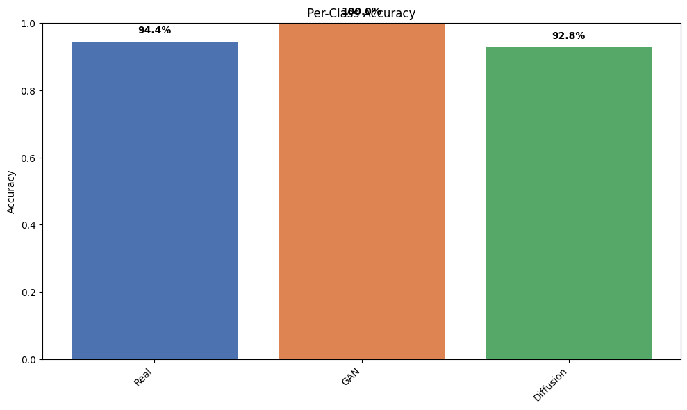

# Phase 01 — Three-Class Synthetic Image Classification

[← Project overview](../README.md) · [Notebook](01_three_class_classification.ipynb)

## Objective

Develop a model that distinguishes **real images**, **GAN-generated images**, and **diffusion-generated images** using pixel-inconsistency and signal-domain features followed by a custom CNN.

## Method

**Input:** RGB images resized to **224 × 224** pixels.

**Feature extraction:**
- PiD: rounding and reconstruction residuals through RGB/YUV conversion (3 channels).
- Signal cues: high-pass residuals (3), Fourier magnitude maps (3), channel means (3), and channel standard deviations (3).
- Total model input: **15 feature channels**.

**Network:** Four convolutional stages (64 → 128 → 256 → 512 filters) with batch normalization, ReLU, pooling, squeeze-and-excitation blocks in the first two stages, and a dropout-based three-class classification head. **1,636,099 parameters**, all trainable.

**Recorded hyperparameters:**

| Setting | Value |
| --- | --- |
| Classes | Real, GAN, Diffusion |
| Image size | 224 × 224 |
| Batch size | 16 |
| Epochs configured | 10 |
| Random seed | 42 |
| Optimizer | AdamW (max learning rate 0.001) |
| Learning rate | OneCycleLR |
| Loss | Cross-entropy with label smoothing 0.1 |
| Train/validation split | 80% / 20% per class |

## Dataset source and preparation

**Source provided by the project author:** **[GenImage](https://github.com/GenImage-Dataset/GenImage)**, *GenImage: A Million-Scale Benchmark for Detecting AI-Generated Image* (Zhu et al., 2023).

- [Official GitHub — dataset information and download links](https://github.com/GenImage-Dataset/GenImage)
- [Project website — paper, benchmark details, dataset terms](https://genimage-dataset.github.io/)
- [Research paper](https://arxiv.org/abs/2306.08571)

GenImage's standard layout uses **generator name / train or val / ai or nature**. Its `ai` / `nature` directory names correspond to generated / real images. **This notebook does not read those labels directly**: it infers a *three-class* label from generator/folder/filename keywords. A compatible *illustrative* local arrangement is:

```text
C:\Dataset\
├── hybrid_pid_full_data\             # notebook output and saved checkpoints
├── BigGAN\
│   ├── train\ai\...                  # GAN images, based on 'biggan' folder keyword
│   └── train\nature\...              # real images
└── Stable Diffusion V1.4\
    ├── train\ai\...                  # diffusion images, based on 'stable' keyword
    └── train\nature\...              # real images
```

This is an **example of how the code's heuristic would interpret directories, not a record of the exact folders used in the experiment**. The code scans the *parent of* `WORK_DIR`. If your dataset is stored elsewhere, update that scan path in the notebook. Verify that the selected generators are mapped correctly: not every generator named by the full GenImage benchmark is included in the notebook's keyword rules. In particular, don't assume an unlabeled `ai/` directory is automatically treated as GAN or Diffusion.

The recorded run discovered and balanced the following **locally prepared** image collection:

| Category | Discovered | Used after balancing |
| --- | ---: | ---: |
| Real | 17,500 | 2,500 |
| GAN | 2,500 | 2,500 |
| Diffusion | 15,000 | 2,500 |
| **Total** | **35,000** | **7,500** |

The balanced set was divided into **6,000 training** and **1,500 validation** images (500 per class in validation). The original notebook does **not** retain the exact image list, dataset hashes, or generator-subset manifest. Consequently, the *GenImage attribution is supported by the author's dataset reference, but the precise 7,500-image subset cannot be verified independently from the files*. No images are redistributed in this repository. The upstream [GenImage terms](https://genimage-dataset.github.io/) include non-commercial usage restrictions.

## Recorded results

**Overall validation accuracy: 95.73%** (1,436 correctly classified of 1,500 images). This is the accuracy loaded from an existing checkpoint in the supplied notebook output.

| Class | Precision | Recall | F1-score | Support |
| --- | ---: | ---: | ---: | ---: |
| Real | 94.40% | 94.40% | 94.40% | 500 |
| GAN | 98.23% | 100.00% | 99.11% | 500 |
| Diffusion | 94.50% | 92.80% | 93.64% | 500 |

### Confusion matrix

Rows are the true classes; columns are predicted classes.

| True / predicted | Real | GAN | Diffusion |
| --- | ---: | ---: | ---: |
| Real | 472 | 1 | 27 |
| GAN | 0 | 500 | 0 |
| Diffusion | 28 | 8 | 464 |



Recorded evidence: [Classification CSV](../results/phase-01/classification_report.csv) · [Execution log](../results/phase-01/validation_log.txt).

## How to run

1. Install the root project's dependencies (`pip install -r requirements.txt`).
2. Download your chosen [GenImage subset](https://github.com/GenImage-Dataset/GenImage) from the official links and prepare the data locally (not included here). Verify the notebook's generator-to-class rules.
3. Open [the notebook](01_three_class_classification.ipynb). Set `WORK_DIR` to your local checkpoint/output folder and change the `load_dataset_from_directory(os.path.join(WORK_DIR, ".."))` call to the true data root if needed.
4. If beginning a new experiment, use an empty checkpoint directory; otherwise the training code may automatically resume and **skip training** if the configured 10 epochs are complete.
5. Execute sequentially and compare your reproduced metrics with those reported here.

## Limitations

- Filename/path keyword matching is only a heuristic; incorrect labels are possible.
- The notebook's recorded execution loaded a trained checkpoint; it did not independently reproduce the earlier training process.
- This three-class validation result does not demonstrate robustness to unseen generators or image transformations; those questions are explored separately in Phase 02.
